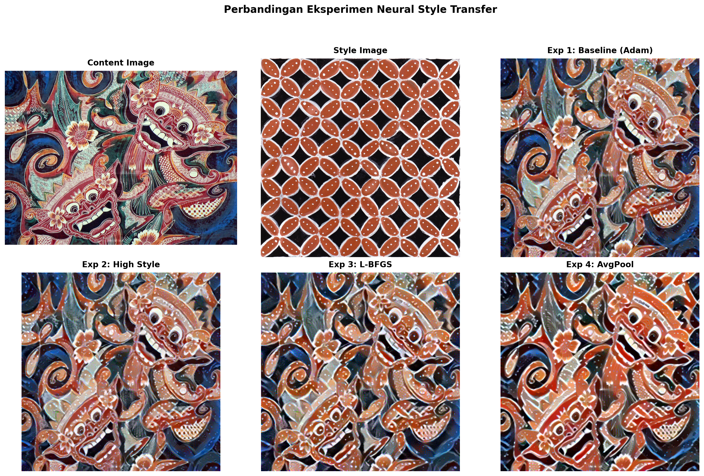

# Neural Style Transfer (Vibe Coding from Scratch)

Implementasi **Neural Style Transfer (NST)** berbasis optimasi piksel secara modular dari dasar (*from scratch*) menggunakan PyTorch dan ekstraktor fitur **VGG-19** beku. Proyek ini memadukan struktur konten (*content*) dan tekstur gaya (*style*) dengan mengoptimalkan tensor citra target secara langsung melalui perhitungan manual **Gram Matrix**, **Content Loss**, **Style Loss**, dan **Total Variation Loss**.

---

## 1. Deskripsi Proyek & Konsep Inti

Alih-alih melatih model generatif baru, algoritma NST pada proyek ini mempertahankan seluruh bobot jaringan konvolusional **VGG-19** (`VGG19_Weights.DEFAULT` dari `torchvision.models`) dalam keadaan beku (`requires_grad=False`, mode `eval()`), lalu memperbarui piksel citra target (`target_img`) secara iteratif agar meminimalkan kombinasi Content Loss dan Style Loss.

### Ekstraksi Fitur Tengah VGG-19 (`src/vgg_extractor.py`)
Backbone `vgg19.features` dipotong hingga indeks `28` (`features[:29]`) dengan seluruh `nn.ReLU(inplace=True)` diganti menjadi `nn.ReLU(inplace=False)` agar aktivasi tidak tertimpa selama *backward pass*. Tersedia pula opsi `--avg-pool` untuk mengganti `nn.MaxPool2d` menjadi `nn.AvgPool2d`.

- **Content Layer (`CONTENT_LAYERS`):**
  - `conv4_2` (indeks `21`) — merepresentasikan struktur dan tata letak objek tingkat menengah-tinggi.
- **Style Layers (`STYLE_LAYERS`):**
  - `conv1_1` (`0`), `conv2_1` (`5`), `conv3_1` (`10`), `conv4_1` (`19`), dan `conv5_1` (`28`) — menangkap pola tekstur dan warna dari skala halus hingga kasar, dengan bobot default merata `0.2` per layer (`DEFAULT_STYLE_WEIGHTS`).

### Formulasi Gram Matrix & Fungsi Loss Manual (`src/losses.py`)
Seluruh perhitungan loss ditulis secara eksplisit tanpa `nn.MSELoss`:

1. **Gram Matrix (`compute_gram_matrix`):**
   Untuk peta fitur berdimensi `(1, C, H, W)`, tensor di-reshape menjadi matriks $F \in \mathbb{R}^{C \times (HW)}$ lalu dihitung korelasi antar-channel yang dinormalisasi:
   $$G = \frac{F F^\top}{C \cdot H \cdot W} \in \mathbb{R}^{C \times C}$$
   *(Untuk `B > 1`, perhitungan dilakukan per sampel menggunakan `torch.bmm` menghasilkan `(B, C, C)`).*
2. **Content Loss (`compute_content_loss`):** Mean Squared Error manual antara aktivasi `conv4_2` citra target dan citra konten (dengan `.detach()` pada fitur referensi).
3. **Style Loss (`compute_style_loss`):** Jumlah berbobot MSE manual antara Gram Matrix citra target dan citra gaya pada kelima *style layers*.
4. **Total Variation Loss (`compute_total_variation_loss`, opsional):** Penalti kehalusan spasial berbasis selisih absolut piksel bertetangga vertikal dan horizontal.
5. **Total Loss (`compute_total_loss`):**
   $$\mathcal{L}_{\text{total}} = \alpha \mathcal{L}_{\text{content}} + \beta \mathcal{L}_{\text{style}} + w_{\text{tv}} \mathcal{L}_{\text{tv}}$$

---

## 2. Struktur Direktori Proyek

```text
Vibe-Coding_Neural-Style-Transfer/
├── main.py                              # Entry point CLI untuk menjalankan pipeline NST
├── AGENTS.md                            # Aturan pengembangan proyek
├── .gitignore                           # Konfigurasi file/direktori yang diabaikan Git
├── src/
│   ├── preprocessing.py                 # Pemuatan citra RGB, resize, normalisasi & denormalisasi ImageNet
│   ├── vgg_extractor.py                 # Ekstraktor fitur VGG-19 beku (content & style layers)
│   ├── losses.py                        # Implementasi manual Gram Matrix, Content, Style, TV & Total Loss
│   ├── trainer.py                       # Loop optimasi piksel (Adam / L-BFGS), clamping & artefak output
│   └── visualize_grid.py                # Skrip pembuat kolase grid 2x3 perbandingan eksperimen
├── data/
│   ├── content/
│   │   └── batik-content1.jpg           # Citra content sampel
│   └── style/
│       └── batik-style1.jpg             # Citra style sampel
├── outputs/
│   ├── exp1_baseline/                   # Artefak Eksperimen 1 (Baseline Adam)
│   ├── exp2_high_style/                 # Artefak Eksperimen 2 (High Style)
│   ├── exp3_lbfgs/                      # Artefak Eksperimen 3 (L-BFGS)
│   ├── exp4_avgpool/                    # Artefak Eksperimen 4 (AvgPool2d)
│   ├── smoke_test/                      # Artefak pengujian smoke test
│   └── perbandingan_eksperimen.png      # Gambar kolase grid 2x3 keempat eksperimen
└── docs/
    ├── LOG_INTERAKSI_LLM_FINAL.md       # Rekapitulasi lengkap log interaksi LLM (Sesi 01–05)
    └── llm_logs/                        # Log kronologis pengembangan per sesi
        ├── sesi_01_preprocessing.md
        ├── sesi_02_vgg_extractor.md
        ├── sesi_03_losses.md
        ├── sesi_04_trainer_main.md
        └── sesi_05_eksperimen.md
```

> **Catatan:** Direktori `.venv/` (virtual environment lokal) dan `.torch_cache/` (cache otomatis bobot `VGG19_Weights.DEFAULT` melalui `TORCH_HOME`) diabaikan oleh Git melalui `.gitignore`.

---

## 3. Instalasi Environment & Menjalankan CLI `main.py`

### A. Instalasi Environment

Proyek ini dijalankan pada **Python 3.13** dengan pustaka utama `torch`, `torchvision`, `pillow`, dan `matplotlib` (lingkungan pengembangan terverifikasi: `torch 2.6.0+cu124`, `torchvision 0.21.0+cu124`, `pillow 13.0.0`, `matplotlib 3.11.2`).

1. **Buat dan aktifkan virtual environment:**
   - **Windows (PowerShell):**
     ```powershell
     python -m venv .venv
     .\.venv\Scripts\Activate.ps1
     ```
   - **Linux / macOS (Bash):**
     ```bash
     python3 -m venv .venv
     source .venv/bin/activate
     ```

2. **Install dependensi:**
   - **Dengan CUDA (GPU NVIDIA, contoh CUDA 12.4):**
     ```bash
     pip install torch torchvision --index-url https://download.pytorch.org/whl/cu124
     pip install pillow matplotlib
     ```
   - **CPU only:**
     ```bash
     pip install torch torchvision pillow matplotlib
     ```

*(Jika sudah menggunakan `.venv` yang tersedia di workspace, environment dapat langsung dipakai via `.\.venv\Scripts\python.exe`.)*

### B. Menjalankan Perintah CLI `main.py`

Melihat seluruh opsi argumen CLI:

```bash
python main.py --help
```

#### Daftar Argumen `main.py`

| Argumen | Tipe | Default | Keterangan |
| :--- | :--- | :--- | :--- |
| `--content` | `str` | *(wajib)* | Path menuju file citra content |
| `--style` | `str` | *(wajib)* | Path menuju file citra style |
| `--size` | `int` | `512` | Ukuran spasial target resize citra (`H = W`) |
| `--steps` | `int` | `300` | Jumlah iterasi/langkah optimasi piksel |
| `--alpha` | `float` | `1.0` | Bobot *Content Loss* ($\alpha$) |
| `--beta` | `float` | `1e6` | Bobot *Style Loss* ($\beta$) |
| `--tv-weight` | `float` | `0.0` | Bobot *Total Variation Loss* ($w_{\text{tv}}$) |
| `--lr` | `float` | `None` | Learning rate (`0.05` untuk `adam`, `1.0` untuk `lbfgs` jika tidak diisi) |
| `--optimizer` | `adam` \| `lbfgs` | `adam` | Optimizer untuk memperbarui piksel citra target |
| `--init` | `content` \| `noise` | `content` | Mode inisialisasi citra target |
| `--avg-pool` | *flag* | `False` | Mengganti `MaxPool2d` pada VGG-19 menjadi `AvgPool2d` |
| `--output-dir` | `str` | `outputs` | Direktori penyimpanan `result.png`, `loss_history.csv`, `loss_curve.png`, dan `progress/` |
| `--save-every` | `int` | `None` | Interval langkah untuk menyimpan gambar progres berkala ke `progress/` |

#### Contoh Penggunaan

1. **Menjalankan dengan konfigurasi default:**
   ```bash
   python main.py --content data/content/batik-content1.jpg --style data/style/batik-style1.jpg
   ```

2. **Contoh skenario eksperimen (Adam, L-BFGS, dan AvgPool):**
   ```bash
   # Baseline Adam (alpha=1.0, beta=1e4)
   python main.py --content data/content/batik-content1.jpg --style data/style/batik-style1.jpg --size 384 --steps 300 --alpha 1.0 --beta 1e4 --optimizer adam --save-every 60 --output-dir outputs/exp1_baseline

   # High Style (alpha=1.0, beta=1e6)
   python main.py --content data/content/batik-content1.jpg --style data/style/batik-style1.jpg --size 384 --steps 300 --alpha 1.0 --beta 1e6 --optimizer adam --save-every 60 --output-dir outputs/exp2_high_style

   # Optimizer L-BFGS (alpha=1.0, beta=1e5, 200 steps)
   python main.py --content data/content/batik-content1.jpg --style data/style/batik-style1.jpg --size 384 --steps 200 --alpha 1.0 --beta 1e5 --optimizer lbfgs --save-every 40 --output-dir outputs/exp3_lbfgs

   # AvgPool2d (alpha=1.0, beta=1e5)
   python main.py --content data/content/batik-content1.jpg --style data/style/batik-style1.jpg --size 384 --steps 300 --alpha 1.0 --beta 1e5 --avg-pool --save-every 60 --output-dir outputs/exp4_avgpool
   ```

3. **Menghasilkan ulang kolase perbandingan 2×3:**
   ```bash
   python -m src.visualize_grid
   ```

Setiap eksekusi `main.py` menghasilkan artefak berikut di dalam `--output-dir`:
- `result.png` — Citra hasil akhir Neural Style Transfer.
- `loss_history.csv` — Riwayat `step`, `content_loss`, `style_loss`, `tv_loss`, dan `total_loss` per langkah.
- `loss_curve.png` — Grafik kurva konvergensi loss.
- `progress/` — Snapshot citra berkala (`step_XXXX.png`) apabila `--save-every` diaktifkan.

---

## 4. Perbandingan Metrik Loss Keempat Eksperimen

Nilai berikut diambil langsung dari berkas `loss_history.csv` pada masing-masing folder eksperimen di `outputs/` (keempat eksperimen menghasilkan `result.png` beresolusi `384 × 384` RGB, diinisialisasi dari citra content karena `content_loss = 0.0` pada `step = 1`, dan mencatat `tv_loss = 0.0` di seluruh langkah):

| Eksperimen | Direktori Output | Total Step | Bobot ($\alpha$, $\beta$) | Content Loss Awal (Step 1) | Style Loss Awal (Step 1) | Total Loss Awal (Step 1) | Content Loss Akhir | Style Loss Akhir | Total Loss Akhir |
| :--- | :--- | :---: | :---: | :---: | :---: | :---: | :---: | :---: | :---: |
| **Exp 1: Baseline (Adam)** | [outputs/exp1_baseline](outputs/exp1_baseline/loss_history.csv) | 300 | $\alpha = 1.0$, $\beta = 10^4$ | `0.000000` | `0.106595` | `1065.946899` | **`80.141472`** | **`0.007071`** | **`150.848846`** |
| **Exp 2: High Style** | [outputs/exp2_high_style](outputs/exp2_high_style/loss_history.csv) | 300 | $\alpha = 1.0$, $\beta = 10^6$ | `0.000000` | `0.106595` | `106594.687500` | **`298.947418`** | **`0.002412`** | **`2710.895020`** |
| **Exp 3: L-BFGS** | [outputs/exp3_lbfgs](outputs/exp3_lbfgs/loss_history.csv) | 200 | $\alpha = 1.0$, $\beta = 10^5$ | `0.000000` | `0.106595` | `10659.468750` | **`201.573853`** | **`0.001450`** | **`346.622559`** |
| **Exp 4: AvgPool** | [outputs/exp4_avgpool](outputs/exp4_avgpool/loss_history.csv) | 300 | $\alpha = 1.0$, $\beta = 10^5$ | `0.000000` | `0.000540` | `53.955727` | **`2.815227`** | **`0.000035`** | **`6.283276`** |

### Ringkasan Temuan Eksperimen
- **Trade-off Content vs. Style (`Exp 1` vs. `Exp 2`):** Menaikkan bobot gaya $\beta$ dari $10^4$ ke $10^6$ menurunkan *Style Loss* akhir dari `0.007071` menjadi `0.002412` sehingga motif batik lebih dominan, namun menaikkan *Content Loss* akhir dari `80.141472` menjadi `298.947418`.
- **Efisiensi L-BFGS (`Exp 3`):** Dalam `200` langkah dengan $\beta = 10^5$, optimizer `lbfgs` mencapai *Style Loss* akhir terendah (`0.001450`) di antara konfigurasi berbasis `MaxPool2d`.
- **Pengaruh `AvgPool2d` (`Exp 4`):** Mengganti `MaxPool2d` menjadi `AvgPool2d` memperkecil magnitudo aktivasi fitur dan nilai Gram Matrix secara signifikan sejak langkah pertama (`style_loss` awal `0.000540` vs `0.106595`), menghasilkan transfer warna dan pola yang lebih halus dengan *Style Loss* turun ~93,57% dari step 1 hingga step 300 (`0.000540` $\rightarrow$ `0.000035`).

---

## 5. Visualisasi Perbandingan Eksperimen

Kolase 2 baris × 3 kolom di bawah ini dihasilkan oleh [src/visualize_grid.py](src/visualize_grid.py) dan menampilkan `Content Image` (`data/content/batik-content1.jpg`), `Style Image` (`data/style/batik-style1.jpg`), serta hasil akhir dari keempat eksperimen:


