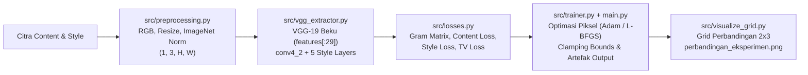

# Log Interaksi LLM Final — Proyek Neural Style Transfer (Vibe Coding from Scratch)

## Identitas Proyek

| Atribut | Keterangan |
| :--- | :--- |
| **Judul Proyek** | Neural Style Transfer (Vibe Coding from Scratch) |
| **Repositori / Workspace** | `Vibe-Coding_Neural-Style-Transfer` |
| **Kontributor / Akun Git** | `dekaaa115` |
| **Periode Pengembangan** | 2026-11-25 s.d. 2026-11-26 (Sesi 01 – Sesi 05) |
| **Lingkungan Eksekusi** | Antigravity IDE Lokal, Python 3.13 (`.venv`), PyTorch & Torchvision (CUDA/CPU), Pillow, Matplotlib |
| **Backbone Fitur** | Pretrained VGG-19 (`VGG19_Weights.DEFAULT`) sebagai ekstraktor fitur beku (`requires_grad=False`, `.eval()`) |
| **Aturan Pengembangan** | [AGENTS.md](file:///d:/SEMESTER%207/GENERATIVE%20AI/Mid%20Test/Vibe-Coding_Neural-Style-Transfer/AGENTS.md) (Modular Bertahap, Tahap Perencanaan Wajib sebelum edit kode, Implementasi Manual Konsep Inti, Debugging Transparan, Dokumentasi Sesi) |
| **Sumber Log Kronologis** | [sesi_01_preprocessing.md](file:///d:/SEMESTER%207/GENERATIVE%20AI/Mid%20Test/Vibe-Coding_Neural-Style-Transfer/docs/llm_logs/sesi_01_preprocessing.md), [sesi_02_vgg_extractor.md](file:///d:/SEMESTER%207/GENERATIVE%20AI/Mid%20Test/Vibe-Coding_Neural-Style-Transfer/docs/llm_logs/sesi_02_vgg_extractor.md), [sesi_03_losses.md](file:///d:/SEMESTER%207/GENERATIVE%20AI/Mid%20Test/Vibe-Coding_Neural-Style-Transfer/docs/llm_logs/sesi_03_losses.md), [sesi_04_trainer_main.md](file:///d:/SEMESTER%207/GENERATIVE%20AI/Mid%20Test/Vibe-Coding_Neural-Style-Transfer/docs/llm_logs/sesi_04_trainer_main.md), [sesi_05_eksperimen.md](file:///d:/SEMESTER%207/GENERATIVE%20AI/Mid%20Test/Vibe-Coding_Neural-Style-Transfer/docs/llm_logs/sesi_05_eksperimen.md) |

---

## Daftar Isi

1. [Identitas Proyek](#identitas-proyek)
2. [Ringkasan Arsitektur VGG-19 NST](#ringkasan-arsitektur-vgg-19-nst)
   - [Alur Pipeline End-to-End](#alur-pipeline-end-to-end)
   - [Peta Modul & Kontrak Tensor](#peta-modul--kontrak-tensor)
   - [Detail Ekstraktor Fitur VGG-19 & Formulasi Loss Manual](#detail-ekstraktor-fitur-vgg-19--formulasi-loss-manual)
3. [Kronologi Sesi 01: Modul Preprocessing (`src/preprocessing.py`)](#kronologi-sesi-01-modul-preprocessing-srcpreprocessingpy)
   - [1. Tahap Inisiasi (Sesi 01)](#1-tahap-inisiasi-sesi-01)
   - [2. Tahap Penanganan Eror / Debugging (Sesi 01)](#2-tahap-penanganan-eror--debugging-sesi-01)
4. [Kronologi Sesi 02: Modul VGG-19 Feature Extractor (`src/vgg_extractor.py`)](#kronologi-sesi-02-modul-vgg-19-feature-extractor-srcvgg_extractorpy)
   - [1. Tahap Inisiasi (Sesi 02)](#1-tahap-inisiasi-sesi-02)
   - [2. Tahap Penanganan Eror / Debugging (Sesi 02)](#2-tahap-penanganan-eror--debugging-sesi-02)
5. [Kronologi Sesi 03: Modul Losses & Gram Matrix (`src/losses.py`)](#kronologi-sesi-03-modul-losses--gram-matrix-srclossespy)
   - [1. Tahap Inisiasi (Sesi 03)](#1-tahap-inisiasi-sesi-03)
   - [2. Tahap Penanganan Eror / Debugging (Sesi 03)](#2-tahap-penanganan-eror--debugging-sesi-03)
6. [Kronologi Sesi 04: Modul Trainer & CLI Main (`src/trainer.py` & `main.py`)](#kronologi-sesi-04-modul-trainer--cli-main-srctrainerpy--mainpy)
   - [1. Tahap Inisiasi (Sesi 04)](#1-tahap-inisiasi-sesi-04)
   - [2. Tahap Penanganan Eror / Debugging (Sesi 04)](#2-tahap-penanganan-eror--debugging-sesi-04)
7. [Kronologi Sesi 05: Visualisasi Grid & Eksperimen Hyperparameter (`src/visualize_grid.py`)](#kronologi-sesi-05-visualisasi-grid--eksperimen-hyperparameter-srcvisualize_gridpy)
   - [1. Tahap Inisiasi (Sesi 05)](#1-tahap-inisiasi-sesi-05)
   - [2. Analisis Eksperimen Hyperparameter](#2-analisis-eksperimen-hyperparameter)
   - [3. Tahap Penanganan Eror / Debugging (Sesi 05)](#3-tahap-penanganan-eror--debugging-sesi-05)

---

## Ringkasan Arsitektur VGG-19 NST

Proyek ini mengimplementasikan algoritma Neural Style Transfer (NST) berbasis optimasi piksel secara modular dari dasar (*from scratch*), di mana bobot jaringan konvolusional VGG-19 dipertahankan beku dan hanya tensor citra target yang diperbarui oleh optimizer.

### Alur Pipeline End-to-End



### Peta Modul & Kontrak Tensor

| Modul | Peran Utama | Komponen / Simbol Kunci | Bentuk Tensor / Artefak |
| :--- | :--- | :--- | :--- |
| [src/preprocessing.py](file:///d:/SEMESTER%207/GENERATIVE%20AI/Mid%20Test/Vibe-Coding_Neural-Style-Transfer/src/preprocessing.py) | Pemuatan citra RGB, resize, normalisasi ImageNet, dan denormalisasi | `IMAGENET_MEAN`, `IMAGENET_STD`, `DEFAULT_IMAGE_SIZE = 512`, `build_transform`, `load_image`, `load_content_and_style`, `denormalize_tensor`, `tensor_to_image` | Input citra $\rightarrow$ Tensor `(1, 3, H, W)` `float32`; output denormalisasi clamped `[0, 1]` $\rightarrow$ `PIL.Image.Image` RGB |
| [src/vgg_extractor.py](file:///d:/SEMESTER%207/GENERATIVE%20AI/Mid%20Test/Vibe-Coding_Neural-Style-Transfer/src/vgg_extractor.py) | Ekstraksi fitur konten dan gaya dengan bobot VGG-19 beku | `CONTENT_LAYERS`, `STYLE_LAYERS`, `DEFAULT_CONTENT_LAYER_NAMES`, `DEFAULT_STYLE_LAYER_NAMES`, `VGG19FeatureExtractor` | Input `(B, 3, H, W)` $\rightarrow$ `(content_features, style_features)` berupa `dict[str, torch.Tensor]` |
| [src/losses.py](file:///d:/SEMESTER%207/GENERATIVE%20AI/Mid%20Test/Vibe-Coding_Neural-Style-Transfer/src/losses.py) | Implementasi manual Gram Matrix dan seluruh fungsi loss | `DEFAULT_STYLE_WEIGHTS`, `compute_gram_matrix`, `compute_content_loss`, `compute_style_loss`, `compute_total_variation_loss`, `compute_total_loss` | `(1, C, H, W)` $\rightarrow$ Gram `(C, C)` (atau `(B, C, C)` untuk `B > 1`); scalar loss tensor |
| [src/trainer.py](file:///d:/SEMESTER%207/GENERATIVE%20AI/Mid%20Test/Vibe-Coding_Neural-Style-Transfer/src/trainer.py) | Loop optimasi piksel, inisialisasi citra, clamping, pencatatan metrik & plot | `initialize_target_image`, `create_optimizer`, `save_loss_history`, `save_loss_curve`, `run_style_transfer` | `target_img` `(1, 3, H, W)` (`requires_grad=True`); artefak `result.png`, `loss_history.csv`, `loss_curve.png`, `progress/` |
| [main.py](file:///d:/SEMESTER%207/GENERATIVE%20AI/Mid%20Test/Vibe-Coding_Neural-Style-Transfer/main.py) | Titik masuk CLI dan konfigurasi awal `TORCH_HOME` + `Agg` | `parse_args`, `main` | Argumen `--content`, `--style`, `--size`, `--steps`, `--alpha`, `--beta`, `--tv-weight`, `--lr`, `--optimizer`, `--init`, `--avg-pool`, `--output-dir`, `--save-every` |
| [src/visualize_grid.py](file:///d:/SEMESTER%207/GENERATIVE%20AI/Mid%20Test/Vibe-Coding_Neural-Style-Transfer/src/visualize_grid.py) | Kolase grid perbandingan 2×3 hasil eksperimen | `DEFAULT_PANELS`, `load_rgb_image`, `create_comparison_grid`, `parse_args`, `main` | Gambar PNG kolase 2 baris × 3 kolom di [outputs/perbandingan_eksperimen.png](file:///d:/SEMESTER%207/GENERATIVE%20AI/Mid%20Test/Vibe-Coding_Neural-Style-Transfer/outputs/perbandingan_eksperimen.png) |

### Detail Ekstraktor Fitur VGG-19 & Formulasi Loss Manual

1. **Pemotongan & Modifikasi Backbone VGG-19 (`VGG19FeatureExtractor`):**
   - Backbone `vgg19(weights=VGG19_Weights.DEFAULT).features` dipotong hingga indeks `28` (`features[:29]`), seluruh parameter dibekukan (`requires_grad = False`), dan metode `train()` di-override agar modul tetap pada mode `eval()`.
   - Seluruh `nn.ReLU(inplace=True)` diganti menjadi `nn.ReLU(inplace=False)` agar aktivasi yang disimpan untuk backward pass tidak tertimpa secara *in-place*.
   - Opsi `use_avg_pool=True` mengganti `nn.MaxPool2d` (indeks `4, 9, 18, 27`) menjadi `nn.AvgPool2d` dengan `kernel_size`, `stride`, dan `padding` yang identik.
   - Layer ekstraksi yang digunakan:
     - **Content Layer (`CONTENT_LAYERS`):** `{21: "conv4_2"}`
     - **Style Layers (`STYLE_LAYERS`):** `{0: "conv1_1", 5: "conv2_1", 10: "conv3_1", 19: "conv4_1", 28: "conv5_1"}` (bobot default merata `0.2` per layer via `DEFAULT_STYLE_WEIGHTS`).
2. **Formulasi Manual Loss:**
   - **Gram Matrix:** Untuk peta fitur `(1, C, H, W)`, tensor di-reshape menjadi $F \in \mathbb{R}^{C \times (HW)}$ lalu dihitung:
     $$G = \frac{F F^\top}{C \cdot H \cdot W} \in \mathbb{R}^{C \times C}$$
     (untuk `B > 1`, digunakan `torch.bmm` menghasilkan `(B, C, C)`).
   - **Content Loss & Style Loss:** Dihitung secara manual tanpa `nn.MSELoss` menggunakan `torch.mean((a - b) * (a - b))` dengan `.detach()` pada fitur target.
   - **Total Variation Loss (Opsional):** Rata-rata selisih absolut piksel bertetangga vertikal dan horizontal.
   - **Total Loss:**
     $$\mathcal{L}_{\text{total}} = \alpha \mathcal{L}_{\text{content}} + \beta \mathcal{L}_{\text{style}} + w_{\text{tv}} \mathcal{L}_{\text{tv}}$$

---

## Kronologi Sesi 01: Modul Preprocessing (`src/preprocessing.py`)

- **Tanggal Sesi:** 2026-11-25
- **Target Modul:** [src/preprocessing.py](file:///d:/SEMESTER%207/GENERATIVE%20AI/Mid%20Test/Vibe-Coding_Neural-Style-Transfer/src/preprocessing.py)
- **Keterangan Sesi:** Antigravity IDE Lokal

### 1. Tahap Inisiasi (Sesi 01)

#### Prompt Lengkap

Prompt inisiasi & perencanaan modul:
```text
Kita akan membangun modul pertama untuk proyek Neural Style Transfer, yaitu src/preprocessing.py. Saya butuh fungsi untuk memuat gambar content dan style menggunakan PyTorch dan Pillow (pastikan otomatis dikonversi ke RGB agar aman untuk file PNG), mengubah ukurannya ke resolusi target (default 256 atau 512 px) tanpa merusak konsistensi tensor (1, 3, H, W), menerapkan normalisasi ImageNet (mean=[0.485, 0.456, 0.406], std=[0.229, 0.224, 0.225]), serta fungsi tensor_to_image untuk denormalisasi dan clamping ke [0, 1]. Jangan buat atau ubah file apa pun dulu. Paparkan rencana desain fungsi dan bentuk tensornya di chat ini, lalu tunggu persetujuan saya.
```

Prompt persetujuan penulisan kode:
```text
LANJUTKAN
```

#### Alasan Khusus
1. **Kepatuhan Aturan Modular & Perencanaan Wajib (`AGENTS.md`):** Desain fungsi, konstanta, tipe input-output, dan bentuk tensor dipaparkan terlebih dahulu di chat sebelum membuat atau mengubah file apa pun, lalu eksekusi baru dilakukan setelah pengguna mengirim `LANJUTKAN`.
2. **Keamanan Format PNG dengan `.convert("RGB")`:** Gambar PNG dapat berformat `RGBA` (4 channel) atau grayscale `L` / palette `P`. Pemanggilan `img.convert("RGB")` memastikan seluruh gambar selalu memiliki 3 channel warna sebelum dikonversi ke tensor.
3. **Konsistensi Dimensi Batch `(1, 3, H, W)`:** `load_image` dan `load_content_and_style` melakukan `.unsqueeze(0)` setelah pipeline `Resize -> ToTensor -> Normalize`, sehingga output selalu berupa tensor 4D `(1, 3, H, W)` bertipe `torch.float32` yang siap diproses oleh VGG-19.
4. **Normalisasi & Denormalisasi ImageNet dengan Clamping `[0, 1]`:** Normalisasi menggunakan `IMAGENET_MEAN = (0.485, 0.456, 0.406)` dan `IMAGENET_STD = (0.229, 0.224, 0.225)`. Untuk mengembalikan tensor hasil optimasi menjadi citra, `denormalize_tensor` melakukan `.detach().clone().cpu().to(torch.float32)`, membalikkan normalisasi ($x \cdot \sigma + \mu$), dan melakukan `torch.clamp(denorm, 0.0, 1.0)` sebelum `tensor_to_image` mengonversinya ke `PIL.Image.Image` mode `"RGB"`.

#### Cuplikan Kode Krusial (`src/preprocessing.py`)

```python
IMAGENET_MEAN: tuple[float, float, float] = (0.485, 0.456, 0.406)
IMAGENET_STD: tuple[float, float, float] = (0.229, 0.224, 0.225)
DEFAULT_IMAGE_SIZE: int = 512


def load_image(
    image_path: str | Path,
    target_size: int | tuple[int, int] = DEFAULT_IMAGE_SIZE,
    keep_aspect_ratio: bool = False,
    device: torch.device | str | None = None,
) -> torch.Tensor:
    path = Path(image_path)
    if not path.is_file():
        raise FileNotFoundError(f"Image file not found: {path}")

    transform = build_transform(
        target_size=target_size,
        keep_aspect_ratio=keep_aspect_ratio,
    )

    with Image.open(path) as img:
        rgb_image = img.convert("RGB")
        tensor = transform(rgb_image).unsqueeze(0)

    if device is not None:
        tensor = tensor.to(device)

    return tensor
```

```python
def denormalize_tensor(tensor: torch.Tensor) -> torch.Tensor:
    if tensor.ndim == 4:
        if tensor.shape[0] != 1 or tensor.shape[1] != 3:
            raise ValueError(
                f"Expected 4D tensor with shape (1, 3, H, W), got {tuple(tensor.shape)}."
            )
        view_shape = (1, 3, 1, 1)
    elif tensor.ndim == 3:
        if tensor.shape[0] != 3:
            raise ValueError(
                f"Expected 3D tensor with shape (3, H, W), got {tuple(tensor.shape)}."
            )
        view_shape = (3, 1, 1)
    else:
        raise ValueError(
            f"Expected 3D or 4D tensor, got {tensor.ndim}D tensor with shape {tuple(tensor.shape)}."
        )

    denorm = tensor.detach().clone().cpu().to(torch.float32)
    mean = torch.tensor(IMAGENET_MEAN, dtype=denorm.dtype).view(*view_shape)
    std = torch.tensor(IMAGENET_STD, dtype=denorm.dtype).view(*view_shape)

    denorm = denorm * std + mean
    return torch.clamp(denorm, 0.0, 1.0)


def tensor_to_image(tensor: torch.Tensor) -> Image.Image:
    clamped = denormalize_tensor(tensor)
    image_tensor = clamped.squeeze(0) if clamped.ndim == 4 else clamped
    return transforms.ToPILImage()(image_tensor)
```

### 2. Tahap Penanganan Eror / Debugging (Sesi 01)

#### Pesan Eror Konsol Utuh
```text
TypeError: load_image() got an unexpected keyword argument 'size'
```

#### Prompt Perbaikan / Pelaporan Pengguna
Pengguna melaporkan kemunculan error `TypeError: load_image() got an unexpected keyword argument 'size'` saat menutup sesi modul `src/preprocessing.py` dan meminta analisis kecocokan parameter fungsinya untuk didokumentasikan.

#### Analisis Akar Masalah & Kecocokan Parameter Fungsi
1. **Akar Masalah:**
   Pada [src/preprocessing.py](file:///d:/SEMESTER%207/GENERATIVE%20AI/Mid%20Test/Vibe-Coding_Neural-Style-Transfer/src/preprocessing.py), fungsi `load_image` (baris 58–63) mendefinisikan parameter resolusi dengan nama `target_size`, bukan `size`:
   ```python
   def load_image(
       image_path: str | Path,
       target_size: int | tuple[int, int] = DEFAULT_IMAGE_SIZE,
       keep_aspect_ratio: bool = False,
       device: torch.device | str | None = None,
   ) -> torch.Tensor:
   ```
   Ketika pemanggil (*caller*) memanggil fungsi menggunakan *keyword argument* `size=...` (misalnya `load_image("gambar.png", size=512)` atau `size=256`), Python menolak argumen tersebut karena `size` tidak ada dalam daftar parameter formal `load_image` dan fungsi tidak menerima `**kwargs`.

2. **Audit Kecocokan Parameter di Seluruh `src/preprocessing.py`:**
   - `build_transform(target_size=DEFAULT_IMAGE_SIZE, keep_aspect_ratio=False)` (baris 16–19): menggunakan **`target_size`**.
   - `load_image(image_path, target_size=DEFAULT_IMAGE_SIZE, keep_aspect_ratio=False, device=None)` (baris 58–63): menggunakan **`target_size`** dan meneruskannya ke `build_transform(target_size=target_size, ...)`.
   - `load_content_and_style(content_path, style_path, target_size=DEFAULT_IMAGE_SIZE, match_style_to_content=True, keep_aspect_ratio=False, device=None)` (baris 94–101): menggunakan **`target_size`** dan meneruskannya ke `load_image(..., target_size=...)`.
   - `denormalize_tensor(tensor)` (baris 138) dan `tensor_to_image(tensor)` (baris 172): hanya menerima parameter `tensor`.

   Secara internal antar-fungsi di dalam `src/preprocessing.py`, penggunaan nama `target_size` sudah konsisten. Ketidakcocokan hanya terjadi antara asumsi *caller* (`size=...`) dengan *signature* fungsi (`target_size=...`).

3. **Solusi:**
   - **Penyesuaian di sisi pemanggil (*caller*):** Gunakan *keyword argument* `target_size=...` (contoh: `load_image("content.png", target_size=512)`) atau argumen posisional (`load_image("content.png", 512)`).
   - **Catatan kompatibilitas (untuk modul lanjutan):** Modul pipeline/training/CLI yang mengimpor `load_image` atau `load_content_and_style` pada sesi berikutnya selalu menggunakan parameter `target_size` (atau menambahkan dukungan alias `size` bila diperlukan).

---

## Kronologi Sesi 02: Modul VGG-19 Feature Extractor (`src/vgg_extractor.py`)

- **Tanggal Sesi:** 2026-11-25
- **Target Modul:** [src/vgg_extractor.py](file:///d:/SEMESTER%207/GENERATIVE%20AI/Mid%20Test/Vibe-Coding_Neural-Style-Transfer/src/vgg_extractor.py)
- **Keterangan Sesi:** Antigravity IDE Lokal

### 1. Tahap Inisiasi (Sesi 02)

#### Prompt Lengkap

Prompt inisiasi & perencanaan modul:
```text
Berdasarkan @src/preprocessing.py, rancang modul kedua yaitu src/vgg_extractor.py. Buat kelas VGG19FeatureExtractor(nn.Module) menggunakan torchvision.models.vgg19(weights=VGG19_Weights.DEFAULT).features. Bekukan seluruh bobot (requires_grad=False) dan jalankan dalam mode .eval(). Ekstrak aktivasi pada conv4_2 (indeks 21) sebagai fitur konten, serta conv1_1, conv2_1, conv3_1, conv4_1, dan conv5_1 (indeks 0, 5, 10, 19, 28) sebagai fitur gaya dalam bentuk dictionary. Tambahkan parameter opsional use_avg_pool: bool = False untuk mengganti semua nn.MaxPool2d menjadi nn.AvgPool2d. Jangan buat atau edit file dulu, paparkan rencana desainnya di chat ini dan tunggu persetujuan saya.
```

Prompt persetujuan penulisan kode:
```text
LANJUTKAN
```

#### Alasan Khusus
1. **Kepatuhan Aturan Perencanaan Wajib (`AGENTS.md`):** Arsitektur kelas `VGG19FeatureExtractor`, pemetaan indeks layer VGG-19, tipe kembalian `(content_features, style_features)`, serta bentuk tensor pada setiap layer dipaparkan lebih dulu dan baru ditulis setelah persetujuan `LANJUTKAN`.
2. **Ekstraktor Fitur Beku (`requires_grad=False` & `.eval()`):** Sesuai konsep Neural Style Transfer, bobot VGG-19 hanya dipakai sebagai pengekstrak fitur tetap (bukan dilatih). Selain `requires_grad = False` dan `self.eval()`, metode `train()` di-override agar `self.features` tetap berada dalam mode `eval()` apabila ada pemanggilan `.train()` dari luar.
3. **Pemotongan Layer hingga Indeks 28 (`features[:29]`):** Indeks target terdalam adalah `conv5_1` (indeks `28`). Layer `29..36` tidak pernah digunakan sehingga dipotong untuk menghemat komputasi saat forward pass berulang di loop optimasi piksel, tanpa mengubah indeks `0..28`.
4. **Penggantian `ReLU(inplace=True)` menjadi `ReLU(inplace=False)`:** Seluruh layer ekstraksi target (`0, 5, 10, 19, 21, 28`) adalah layer `Conv2d` tepat sebelum `ReLU(inplace=True)` bawaan `torchvision`. Mengubah `inplace=False` mencegah tensor aktivasi yang sudah disimpan ke dictionary tertimpa secara *in-place* dan menghindari kegagalan autograd saat `loss.backward()`.
5. **Dukungan `use_avg_pool`:** Mengganti seluruh `nn.MaxPool2d` (indeks `4, 9, 18, 27`) menjadi `nn.AvgPool2d` dengan `kernel_size`, `stride`, dan `padding` yang identik untuk opsi aliran gradien yang lebih halus pada NST.
6. **Isolasi Cache Bobot Lokal (`TORCH_HOME`):** Mengarahkan `TORCH_HOME` ke `.torch_cache` dan menambahkannya ke `.gitignore` agar bobot VGG-19 (~548 MB) tersimpan di direktori proyek yang memiliki izin tulis dan tidak ikut ter-push ke GitHub.

#### Cuplikan Kode Krusial (`src/vgg_extractor.py`)

```python
import os

os.environ.setdefault("TORCH_HOME", ".torch_cache")

import torch
import torch.nn as nn
from torchvision.models import VGG19_Weights, vgg19

CONTENT_LAYERS: dict[int, str] = {
    21: "conv4_2",
}

STYLE_LAYERS: dict[int, str] = {
    0: "conv1_1",
    5: "conv2_1",
    10: "conv3_1",
    19: "conv4_1",
    28: "conv5_1",
}
```

```python
class VGG19FeatureExtractor(nn.Module):
    def __init__(self, use_avg_pool: bool = False, freeze: bool = True) -> None:
        super().__init__()
        self.use_avg_pool = use_avg_pool
        self._frozen = freeze

        max_layer_idx = max(*CONTENT_LAYERS.keys(), *STYLE_LAYERS.keys())
        backbone = vgg19(weights=VGG19_Weights.DEFAULT).features[: max_layer_idx + 1]

        layers: list[nn.Module] = []
        for layer in backbone:
            if use_avg_pool and isinstance(layer, nn.MaxPool2d):
                layers.append(
                    nn.AvgPool2d(
                        kernel_size=layer.kernel_size,
                        stride=layer.stride,
                        padding=layer.padding,
                    )
                )
            elif isinstance(layer, nn.ReLU):
                layers.append(nn.ReLU(inplace=False))
            else:
                layers.append(layer)

        self.features = nn.Sequential(*layers)

        if freeze:
            for param in self.features.parameters():
                param.requires_grad = False

        self.eval()
```

### 2. Tahap Penanganan Eror / Debugging (Sesi 02)

#### Pesan Eror Konsol Utuh
```text
Traceback (most recent call last):
  File "<string>", line 14, in <module>
    ext_max = VGG19FeatureExtractor(use_avg_pool=False)
  File "D:\SEMESTER 7\GENERATIVE AI\Mid Test\Vibe-Coding_Neural-Style-Transfer\src\vgg_extractor.py", line 46, in __init__
    backbone = vgg19(weights=VGG19_Weights.DEFAULT).features[: max_layer_idx + 1]
               ~~~~~^^^^^^^^^^^^^^^^^^^^^^^^^^^^^^^
  File "D:\SEMESTER 7\GENERATIVE AI\Mid Test\Vibe-Coding_Neural-Style-Transfer\.venv\Lib\site-packages\torchvision\models\_utils.py", line 142, in wrapper
    return fn(*args, **kwargs)
  File "D:\SEMESTER 7\GENERATIVE AI\Mid Test\Vibe-Coding_Neural-Style-Transfer\.venv\Lib\site-packages\torchvision\models\_utils.py", line 228, in inner_wrapper
    return builder(*args, **kwargs)
  File "D:\SEMESTER 7\GENERATIVE AI\Mid Test\Vibe-Coding_Neural-Style-Transfer\.venv\Lib\site-packages\torchvision\models\vgg.py", line 485, in vgg19
    return _vgg("E", False, weights, progress, **kwargs)
  File "D:\SEMESTER 7\GENERATIVE AI\Mid Test\Vibe-Coding_Neural-Style-Transfer\.venv\Lib\site-packages\torchvision\models\vgg.py", line 105, in _vgg
    model.load_state_dict(weights.get_state_dict(progress=progress, check_hash=True))
                          ~~~~~~~~~~~~~~~~~~~~~~^^^^^^^^^^^^^^^^^^^^^^^^^^^^^^^^^^^^
  File "D:\SEMESTER 7\GENERATIVE AI\Mid Test\Vibe-Coding_Neural-Style-Transfer\.venv\Lib\site-packages\torchvision\models\_api.py", line 90, in get_state_dict
    return load_state_dict_from_url(self.url, *args, **kwargs)
  File "D:\SEMESTER 7\GENERATIVE AI\Mid Test\Vibe-Coding_Neural-Style-Transfer\.venv\Lib\site-packages\torch\hub.py", line 854, in load_state_dict_from_url
    os.makedirs(model_dir, exist_ok=True)
    ~~~~~~~~~~~^^^^^^^^^^^^^^^^^^^^^^^^^^
  File "<frozen os>", line 217, in makedirs
  File "<frozen os>", line 217, in makedirs
  File "<frozen os>", line 227, in makedirs
PermissionError: [WinError 5] Access is denied: 'C:\\Users\\muham/.cache\\torch'
```

#### Prompt Perbaikan Pengguna
```text
Pengujian src/vgg_extractor.py berhasil mengeluarkan fitur setelah cache diarahkan ke lokal. Sebelum sesi ini ditutup, tolong lakukan dua hal: (1) tambahkan os.environ.setdefault('TORCH_HOME', '.torch_cache') di bagian atas src/vgg_extractor.py (sebelum import/pemanggilan vgg19) dan masukkan .torch_cache/ ke .gitignore agar bobot ~548 MB tidak ikut ter-push ke GitHub; (2) buat file docs/llm_logs/sesi_02_vgg_extractor.md sesuai format template proyek, termasuk mencatat kendala PermissionError: [WinError 5] Access is denied: 'C:\\Users\\muham/.cache\\torch' beserta solusinya di bagian Debugging.
```

#### Analisis Akar Masalah dan Solusinya
1. **Akar Masalah:**
   Secara default, `torchvision.models.vgg19(weights=VGG19_Weights.DEFAULT)` memanggil `torch.hub.load_state_dict_from_url(...)` yang mencoba membuat dan menulis direktori cache ke `C:\Users\muham/.cache\torch`. Pada lingkungan eksekusi yang membatasi akses tulis ke direktori profil pengguna (`C:\Users\muham\.cache`), pemanggilan `os.makedirs(model_dir, exist_ok=True)` di `torch\hub.py` gagal dengan `PermissionError: [WinError 5] Access is denied: 'C:\\Users\\muham/.cache\\torch'`.
2. **Solusi yang Diterapkan:**
   - Menambahkan `os.environ.setdefault("TORCH_HOME", ".torch_cache")` di bagian atas [src/vgg_extractor.py](file:///d:/SEMESTER%207/GENERATIVE%20AI/Mid%20Test/Vibe-Coding_Neural-Style-Transfer/src/vgg_extractor.py) sebelum `import torch` dan `from torchvision.models import VGG19_Weights, vgg19`, sehingga PyTorch mengarahkan penyimpanan bobot pretrained ke folder lokal `.torch_cache/` di dalam workspace (sambil tetap menghormati `TORCH_HOME` kustom bila sudah disetel di environment).
   - Menambahkan `.torch_cache/` ke [.gitignore](file:///d:/SEMESTER%207/GENERATIVE%20AI/Mid%20Test/Vibe-Coding_Neural-Style-Transfer/.gitignore) agar file checkpoint VGG-19 (~548 MB) tidak ikut ter-track atau ter-push ke repositori GitHub.

---

## Kronologi Sesi 03: Modul Losses & Gram Matrix (`src/losses.py`)

- **Tanggal Sesi:** 2026-11-25
- **Target Modul:** [src/losses.py](file:///d:/SEMESTER%207/GENERATIVE%20AI/Mid%20Test/Vibe-Coding_Neural-Style-Transfer/src/losses.py)
- **Keterangan Sesi:** Antigravity IDE Lokal

### 1. Tahap Inisiasi (Sesi 03)

#### Prompt Lengkap

Prompt inisiasi & perencanaan modul:
```text
Merujuk langsung pada struktur output forward() di @src/vgg_extractor.py, rancang modul src/losses.py secara modular dari nol tanpa pustaka loss eksternal. Implementasikan: (1) compute_gram_matrix(feature_map) dengan mengubah tensor (B, C, H, W) menjadi matriks (C, H*W), mengalikan matriks dengan transposenya, lalu menormalisasinya dengan membagi terhadap C * H * W; (2) compute_content_loss berbasis MSE; (3) compute_style_loss berbasis MSE berbobot terhadap Gram Matrix di 5 lapisan gaya; (4) compute_total_variation_loss opsional untuk menekan bintik noise; dan (5) compute_total_loss yang menggabungkan alpha * content_loss + beta * style_loss + tv_weight * tv_loss. Jangan buat atau ubah file dulu, paparkan desain fungsi dan dimensinya di chat.
```

Prompt persetujuan penulisan kode:
```text
LANJUTKAN
```

#### Alasan Khusus
1. **Kepatuhan Aturan Perencanaan Wajib (`AGENTS.md`):** Daftar fungsi, konstanta `DEFAULT_STYLE_WEIGHTS`, validasi parameter, alur logika, serta transformasi dimensi tensor input-output dipaparkan terlebih dahulu di chat sebelum membuat file `src/losses.py` setelah persetujuan `LANJUTKAN`.
2. **Implementasi Manual Tanpa Pustaka Loss Eksternal:** Seluruh perhitungan MSE pada `compute_content_loss` dan `compute_style_loss` ditulis eksplisit dari operasi tensor dasar (`torch.mean((a - b) * (a - b))`) tanpa menggunakan `torch.nn.MSELoss` maupun `torch.nn.functional.mse_loss`.
3. **Keselarasan Langsung dengan Output `VGG19FeatureExtractor.forward()`:** Fungsi `compute_content_loss` dan `compute_style_loss` menerima kamus fitur `dict[str, torch.Tensor]` yang dikembalikan oleh `VGG19FeatureExtractor.forward()`, dengan merujuk langsung pada `DEFAULT_CONTENT_LAYER_NAMES` (`"conv4_2"`) dan `DEFAULT_STYLE_LAYER_NAMES` (`"conv1_1"`, `"conv2_1"`, `"conv3_1"`, `"conv4_1"`, `"conv5_1"`).
4. **Perhitungan & Normalisasi Gram Matrix (`C * H * W`):** `compute_gram_matrix` mengubah tensor `(1, C, H, W)` menjadi `(C, H * W)`, menghitung perkalian matriks dengan transposenya (`torch.mm(features, features.t())`) menjadi `(C, C)`, lalu menormalisasinya dengan membagi terhadap `C * H * W`. Untuk `B > 1`, perkalian dilakukan per sampel menggunakan `torch.bmm` sehingga menghasilkan `(B, C, C)` tanpa mencampur statistik antar-gambar.
5. **Isolasi Gradien Target via `.detach()`:** Pada `compute_content_loss` dan `compute_style_loss`, fitur target dipanggil dengan `.detach()` sehingga gradien saat backpropagation hanya mengalir ke gambar yang sedang dioptimasi (`generated_img`).
6. **Total Variation Loss Anisotropik Berbasis `mean`:** `compute_total_variation_loss` menghitung rata-rata nilai absolut selisih piksel bertetangga secara vertikal (`H - 1`) dan horizontal (`W - 1`) agar besarnya penalti tidak meledak saat resolusi gambar berubah, sekaligus bersifat opsional pada `compute_total_loss` (`tv_loss: torch.Tensor | None = None`).

#### Cuplikan Kode Krusial (`src/losses.py`)

```python
DEFAULT_STYLE_WEIGHTS: dict[str, float] = {
    layer_name: 1.0 / len(DEFAULT_STYLE_LAYER_NAMES)
    for layer_name in DEFAULT_STYLE_LAYER_NAMES
}


def compute_gram_matrix(feature_map: torch.Tensor) -> torch.Tensor:
    if feature_map.ndim != 4:
        raise ValueError(
            f"Expected 4D feature map with shape (B, C, H, W), got {tuple(feature_map.shape)}."
        )

    batch_size, channels, height, width = feature_map.shape
    if batch_size <= 0 or channels <= 0 or height <= 0 or width <= 0:
        raise ValueError(
            f"All feature map dimensions must be positive, got {tuple(feature_map.shape)}."
        )

    norm_factor = float(channels * height * width)

    if batch_size == 1:
        features = feature_map.reshape(channels, height * width)
        return torch.mm(features, features.t()) / norm_factor

    features = feature_map.reshape(batch_size, channels, height * width)
    return torch.bmm(features, features.transpose(1, 2)) / norm_factor
```

```python
def compute_content_loss(
    generated_features: dict[str, torch.Tensor],
    target_features: dict[str, torch.Tensor],
    content_layers: tuple[str, ...] = DEFAULT_CONTENT_LAYER_NAMES,
) -> torch.Tensor:
    layers = _validate_feature_layers(
        generated_features, target_features, content_layers, "content"
    )

    layer_losses: list[torch.Tensor] = []
    for layer_name in layers:
        gen_feat = generated_features[layer_name]
        target_feat = target_features[layer_name].detach()

        if gen_feat.shape != target_feat.shape:
            raise ValueError(
                f"Content feature shape mismatch at '{layer_name}': "
                f"{tuple(gen_feat.shape)} vs {tuple(target_feat.shape)}."
            )

        diff = gen_feat - target_feat
        layer_losses.append(torch.mean(diff * diff))

    return torch.stack(layer_losses).mean()
```

```python
def compute_style_loss(
    generated_features: dict[str, torch.Tensor],
    target_features: dict[str, torch.Tensor],
    style_weights: dict[str, float] | None = None,
) -> torch.Tensor:
    weights = DEFAULT_STYLE_WEIGHTS if style_weights is None else style_weights
    if any(weight < 0.0 for weight in weights.values()):
        raise ValueError("All style layer weights must be non-negative.")

    layers = _validate_feature_layers(
        generated_features, target_features, weights.keys(), "style"
    )

    ref_tensor = generated_features[layers[0]]
    total_style_loss = torch.zeros((), dtype=ref_tensor.dtype, device=ref_tensor.device)

    for layer_name in layers:
        weight = weights[layer_name]
        gen_feat = generated_features[layer_name]
        target_feat = target_features[layer_name].detach()
        ...
        gen_gram = compute_gram_matrix(gen_feat)
        target_gram = compute_gram_matrix(target_feat)
        diff = gen_gram - target_gram
        layer_loss = torch.mean(diff * diff)
        total_style_loss = total_style_loss + weight * layer_loss

    return total_style_loss
```

```python
def compute_total_variation_loss(image: torch.Tensor) -> torch.Tensor:
    ...
    tv_loss = torch.zeros((), dtype=image.dtype, device=image.device)

    if height > 1:
        diff_h = image[:, :, 1:, :] - image[:, :, :-1, :]
        tv_loss = tv_loss + torch.mean(torch.abs(diff_h))

    if width > 1:
        diff_w = image[:, :, :, 1:] - image[:, :, :, :-1]
        tv_loss = tv_loss + torch.mean(torch.abs(diff_w))

    return tv_loss


def compute_total_loss(
    content_loss: torch.Tensor,
    style_loss: torch.Tensor,
    tv_loss: torch.Tensor | None = None,
    alpha: float = 1.0,
    beta: float = 1e6,
    tv_weight: float = 0.0,
) -> torch.Tensor:
    if alpha < 0.0 or beta < 0.0 or tv_weight < 0.0:
        raise ValueError("Loss weights alpha, beta, and tv_weight must be non-negative.")

    total_loss = alpha * content_loss + beta * style_loss
    if tv_loss is not None and tv_weight > 0.0:
        total_loss = total_loss + tv_weight * tv_loss

    return total_loss
```

### 2. Tahap Penanganan Eror / Debugging (Sesi 03)

#### Status Eksekusi & Validasi Unit Test
Tidak ditemukan eror maupun bug saat implementasi dan pengujian modul [src/losses.py](file:///d:/SEMESTER%207/GENERATIVE%20AI/Mid%20Test/Vibe-Coding_Neural-Style-Transfer/src/losses.py); seluruh pengujian berjalan mulus pada eksekusi pertama.

#### Rincian Validasi yang Dijalankan
Pengujian dijalankan melalui `.\.venv\Scripts\python.exe` dengan skenario berikut:
1. **`compute_gram_matrix`:**
   - Verifikasi bentuk output `(2, 2)` untuk input `(1, 2, 2, 2)` serta kesesuaian nilai numerik eksak (`[[3.75, 1.625], [1.625, 1.125]]`) terhadap perhitungan manual dengan pembagi `C * H * W = 8`.
   - Verifikasi bentuk output `(2, 4, 4)` untuk input batch `(2, 4, 3, 5)`.
2. **`compute_content_loss`:**
   - Verifikasi MSE manual menghasilkan `2.5` pada pasangan tensor uji dan `0.0` saat tensor identik.
3. **`compute_style_loss`:**
   - Verifikasi bobot 5 lapisan gaya pada `DEFAULT_STYLE_WEIGHTS` (`len == 5`), kompatibilitas resolusi spasial berbeda antara fitur hasil `(1, C, 16, 16)` dan target gaya `(1, C, 12, 20)`, serta loss bernilai `0.0` saat fitur identik.
4. **`compute_total_variation_loss` & `compute_total_loss`:**
   - Verifikasi TV loss `0.0` pada citra konstan `(1, 3, 8, 8)` dan `3.0` pada tensor uji `(1, 1, 2, 2)`, serta verifikasi kombinasi bobot `alpha`, `beta`, dan `tv_weight` (dengan maupun tanpa `tv_loss`).
5. **Uji Integrasi End-to-End dengan `VGG19FeatureExtractor`:**
   - Ekstraksi fitur konten dan gaya dari `VGG19FeatureExtractor(use_avg_pool=True)` pada tensor sintetis `(1, 3, 64, 64)`, dilanjutkan `total.backward()`.
   - Hasil keluaran konsol:
     ```text
     ALL_CHECKS_PASSED
     c_loss=0.000000, s_loss=0.000011, tv_loss=2.275450, total=10.701361
     ```
   - Terverifikasi `generated_img.grad` terisi dengan bentuk `(1, 3, 64, 64)` dan seluruh nilai berhingga (`torch.isfinite`), sementara seluruh parameter VGG-19 tetap beku tanpa gradien (`p.grad is None`).

---

## Kronologi Sesi 04: Modul Trainer & CLI Main (`src/trainer.py` & `main.py`)

- **Tanggal Sesi:** 2026-11-25
- **Target Modul:** [src/trainer.py](file:///d:/SEMESTER%207/GENERATIVE%20AI/Mid%20Test/Vibe-Coding_Neural-Style-Transfer/src/trainer.py) dan [main.py](file:///d:/SEMESTER%207/GENERATIVE%20AI/Mid%20Test/Vibe-Coding_Neural-Style-Transfer/main.py)
- **Keterangan Sesi:** Antigravity IDE Lokal

### 1. Tahap Inisiasi (Sesi 04)

#### Prompt Lengkap

Prompt inisiasi & perencanaan modul:
```text
Integrasikan @src/preprocessing.py, @src/vgg_extractor.py, dan @src/losses.py ke dalam src/trainer.py dan main.py. Pastikan di awal main.py diatur os.environ.setdefault('TORCH_HOME', '.torch_cache') dan backend non-interaktif matplotlib.use('Agg') agar penyimpanan grafik tidak memblokir terminal. Di trainer.py, variabel yang dioptimasi oleh optimizer adalah tensor gambar target (target_img.requires_grad_(True)), bukan bobot VGG-19. Hitung fitur target dari gambar content dan style satu kali di awal di dalam blok torch.no_grad(). Dukung optimizer adam dan lbfgs (lengkap dengan fungsi closure()), opsi inisialisasi citra (content atau noise), penyimpanan gambar progres berkala, pencatatan riwayat content_loss, style_loss, dan total_loss ke loss_history.csv, serta penyimpanan grafik loss_curve.png dan gambar akhir result.png ke folder output. Di main.py, sediakan argumen CLI (--content, --style, --size, --steps, --alpha, --beta, --tv-weight, --lr, --optimizer, --init, --avg-pool, --output-dir). Jangan tulis kode dulu, paparkan rencananya di chat.
```

Prompt persetujuan penulisan kode:
```text
LANJUTKAN
```

#### Alasan Khusus
1. **Kepatuhan Aturan Perencanaan Wajib (`AGENTS.md`):** Arsitektur fungsi pembantu, loop optimasi `run_style_transfer`, dimensi tensor, argumen CLI `main.py`, serta daftar artefak keluaran dipaparkan terlebih dahulu di chat dan baru ditulis ke file setelah persetujuan `LANJUTKAN`.
2. **Pengaturan Environment Awal pada `main.py`:** `os.environ.setdefault("TORCH_HOME", ".torch_cache")` dan `matplotlib.use("Agg")` ditempatkan di baris teratas `main.py` sebelum mengimpor `torch` maupun modul `src.*` agar cache bobot VGG-19 terisolasi di `.torch_cache/` dan penyimpanan grafik `loss_curve.png` tidak memicu GUI matplotlib yang dapat memblokir terminal.
3. **Optimasi Eksplisit pada Tensor Gambar (`target_img.requires_grad_(True)`):** Optimizer (`Adam` maupun `LBFGS`) hanya mengikat `[target_img]` sebagai parameter yang dioptimasi, sementara `extractor` tetap berada dalam mode `.eval()` dan `requires_grad=False`.
4. **Prakomputasi Fitur Target dalam `torch.no_grad()`:** Fitur konten target (`target_content`) dan fitur gaya target (`target_style`) diekstrak satu kali di awal sebelum loop optimasi di dalam blok `with torch.no_grad():` guna menghemat memori dan menghindari pembangunan graf autograd pada gambar referensi.
5. **Penyatuan Alur `closure()` untuk `adam` dan `lbfgs`:** Fungsi `closure()` dipakai bersama oleh mode `adam` dan `lbfgs` (`optimizer.step(closure)` dengan `max_iter=1` pada `LBFGS`) sehingga tidak terjadi duplikasi logika forward/backward, setiap langkah luar berkorespondensi 1:1 dengan baris pada `loss_history.csv`, dan metrik step tercatat akurat.
6. **Clamping Rentang Normalisasi ImageNet & Kurva Loss 3 Panel:** Setelah setiap langkah optimizer, `target_img` di-clamp ke rentang valid `[(0 - mean) / std, (1 - mean) / std]` di dalam `torch.no_grad()`. Selain itu, `save_loss_curve` memplot `total_loss`, `content_loss`, dan `style_loss` pada 3 subplot vertikal terpisah karena skala nilainya berbeda jauh (dan `content_loss` pada step awal bisa bernilai `0.0` saat `init="content"`).

#### Cuplikan Kode Krusial (`src/trainer.py` & `main.py`)

`main.py` (konfigurasi awal & antarmuka CLI):
```python
import os

os.environ.setdefault("TORCH_HOME", ".torch_cache")

import matplotlib

matplotlib.use("Agg")

import argparse
from collections.abc import Sequence

import torch

from src.preprocessing import DEFAULT_IMAGE_SIZE, load_content_and_style
from src.trainer import run_style_transfer
from src.vgg_extractor import VGG19FeatureExtractor
```

```python
def main(argv: Sequence[str] | None = None) -> None:
    args = parse_args(argv)
    device = torch.device("cuda" if torch.cuda.is_available() else "cpu")

    content_img, style_img = load_content_and_style(
        content_path=args.content,
        style_path=args.style,
        target_size=args.size,
        device=device,
    )
    extractor = VGG19FeatureExtractor(use_avg_pool=args.avg_pool).to(device)

    result = run_style_transfer(
        content_img=content_img,
        style_img=style_img,
        extractor=extractor,
        output_dir=args.output_dir,
        steps=args.steps,
        alpha=args.alpha,
        beta=args.beta,
        tv_weight=args.tv_weight,
        optimizer_name=args.optimizer,
        lr=args.lr,
        init_mode=args.init,
        save_every=args.save_every,
    )
```

`src/trainer.py` (prakomputasi fitur target, `closure()`, dan penyimpanan artefak):
```python
    extractor.eval()
    with torch.no_grad():
        target_content, _ = extractor(content_img)
        _, target_style = extractor(style_img)

    target_img = initialize_target_image(content_img, init_mode=init_mode)
    optimizer = create_optimizer(target_img, optimizer_name=optimizer_name, lr=lr)
    min_bounds, max_bounds = _normalized_bounds(target_img.device, target_img.dtype)
```

```python
    def closure() -> torch.Tensor:
        optimizer.zero_grad()
        gen_content, gen_style = extractor(target_img)
        c_loss = compute_content_loss(gen_content, target_content)
        s_loss = compute_style_loss(gen_style, target_style)

        if tv_weight > 0.0:
            tv_loss_tensor: torch.Tensor | None = compute_total_variation_loss(
                target_img
            )
            tv_value = float(tv_loss_tensor.detach().item())
        else:
            tv_loss_tensor = None
            tv_value = 0.0

        total_loss = compute_total_loss(
            content_loss=c_loss,
            style_loss=s_loss,
            tv_loss=tv_loss_tensor,
            alpha=alpha,
            beta=beta,
            tv_weight=tv_weight,
        )
        total_loss.backward()

        latest_metrics["content_loss"] = float(c_loss.detach().item())
        latest_metrics["style_loss"] = float(s_loss.detach().item())
        latest_metrics["tv_loss"] = tv_value
        latest_metrics["total_loss"] = float(total_loss.detach().item())
        return total_loss

    for step in range(1, steps + 1):
        if opt_key == "lbfgs":
            optimizer.step(closure)
        else:
            closure()
            optimizer.step()

        _clamp_to_valid_normalized_range_(target_img, min_bounds, max_bounds)
```

### 2. Tahap Penanganan Eror / Debugging (Sesi 04)

#### Status Eksekusi & Validasi Smoke Test
Tidak ditemukan eror saat implementasi maupun eksekusi [src/trainer.py](file:///d:/SEMESTER%207/GENERATIVE%20AI/Mid%20Test/Vibe-Coding_Neural-Style-Transfer/src/trainer.py) dan [main.py](file:///d:/SEMESTER%207/GENERATIVE%20AI/Mid%20Test/Vibe-Coding_Neural-Style-Transfer/main.py). Seluruh skenario uji CLI berjalan mulus hingga selesai (`Command exited with code 0`).

#### Rincian Validasi CLI End-to-End
Smoke test dijalankan menggunakan `.\.venv\Scripts\python.exe` dengan citra sintetis `80x80` yang di-resize ke `--size 64` di direktori temporer:
1. **Validasi Argumen `--help`:** Memastikan seluruh argumen CLI (`--content`, `--style`, `--size`, `--steps`, `--alpha`, `--beta`, `--tv-weight`, `--lr`, `--optimizer`, `--init`, `--avg-pool`, `--output-dir`) tersedia dan dapat diparsing.
2. **Mode `adam` (`--steps 3 --alpha 1.0 --beta 1e6 --tv-weight 1e-2 --lr 0.05 --optimizer adam --init content --avg-pool --save-every 2`):**
   - Keluaran konsol:
     ```text
     Device: cuda
     Finished 3 steps (adam, init=content) -> total=710.989075, content=1.268032, style=0.000710, tv=0.026959
     ```
   - Artefak terverifikasi terbentuk: `result.png`, `loss_curve.png`, `loss_history.csv` (3 baris dengan header `step,content_loss,style_loss,tv_loss,total_loss`), serta `progress/step_0002.png` dan `progress/step_0003.png`.
3. **Mode `lbfgs` (`--steps 3 --optimizer lbfgs --init noise`):**
   - Keluaran konsol:
     ```text
     Device: cuda
     Finished 3 steps (lbfgs, init=noise) -> total=52130.507812, content=79.976219, style=0.052051, tv=0.000000
     ```
   - Artefak terverifikasi terbentuk: `result.png`, `loss_curve.png`, `loss_history.csv` (3 baris lengkap).
4. **Status Akhir Smoke Test:** `TRAINER_AND_MAIN_VERIFIED`.

---

## Kronologi Sesi 05: Visualisasi Grid & Eksperimen Hyperparameter (`src/visualize_grid.py`)

- **Tanggal Sesi:** 2026-11-26
- **Target Modul:** [src/visualize_grid.py](file:///d:/SEMESTER%207/GENERATIVE%20AI/Mid%20Test/Vibe-Coding_Neural-Style-Transfer/src/visualize_grid.py) dan Evaluasi Eksperimen (`outputs/exp1_baseline`, `outputs/exp2_high_style`, `outputs/exp3_lbfgs`, `outputs/exp4_avgpool`)
- **Keterangan Sesi:** Antigravity IDE Lokal

### 1. Tahap Inisiasi (Sesi 05)

#### Prompt Lengkap

Prompt inisiasi & perencanaan modul `src/visualize_grid.py`:
```text
Buat skrip baru di src/visualize_grid.py menggunakan Pillow atau Matplotlib untuk menyusun grid gambar 2 baris x 3 kolom yang menampilkan: (1) data/content/batik-content1.jpg berjudul 'Content Image', (2) data/style/batik-style1.jpg berjudul 'Style Image', (3) hasil akhir dari outputs/exp1_baseline, (4) hasil akhir dari outputs/exp2_high_style, (5) hasil akhir dari outputs/exp3_lbfgs, dan (6) hasil akhir dari outputs/exp4_avgpool. Simpan hasil kolase ke outputs/perbandingan_eksperimen.png. Jangan buat file dulu, paparkan rencananya di chat ini.
```

Prompt persetujuan penulisan kode:
```text
LANJUTKAN
```

Prompt dokumentasi hasil eksperimen & sesi:
```text
Baca seluruh file log CSV/hasil di folder @outputs/ (exp1_baseline, exp2_high_style, exp3_lbfgs, exp4_avgpool). Buat file baru tepat di path docs/llm_logs/sesi_05_eksperimen.md yang mendokumentasikan seluruh proses pembuatan src/visualize_grid.py, tabel perbandingan nilai Content Loss, Style Loss, dan Total Loss akhir dari keempat eksperimen, serta catatan kendala/debugging jika ada, mengikuti format template resmi proyek.
```

#### Alasan Khusus
1. **Kepatuhan Aturan Perencanaan Wajib (`AGENTS.md`):** Sebelum membuat `src/visualize_grid.py`, pemeriksaan resolusi & mode warna keenam citra sumber, tata letak panel `2 x 3`, daftar konstanta, fungsi (`load_rgb_image`, `create_comparison_grid`, `parse_args`, `main`), dan alur CLI dipaparkan terlebih dahulu di chat lalu baru ditulis setelah persetujuan `LANJUTKAN`.
2. **Kombinasi Pillow (`.convert("RGB")`) dan Matplotlib Backend `Agg`:** `load_rgb_image` membuka citra via Pillow dan mengonversinya ke mode `"RGB"` agar aman terhadap berbagai format gambar, sedangkan rendering grid menggunakan `matplotlib.use("Agg")` (konsisten dengan [main.py](file:///d:/SEMESTER%207/GENERATIVE%20AI/Mid%20Test/Vibe-Coding_Neural-Style-Transfer/main.py)) agar proses ekspor PNG tidak memicu GUI dan tidak memblokir terminal.
3. **Menjaga Rasio Aspek Citra Sumber (`target_size=None` Default):** Hasil pemeriksaan file menunjukkan perbedaan dimensi asli antara `data/content/batik-content1.jpg` (`1280 x 960`, rasio `4:3`), `data/style/batik-style1.jpg` (`1776 x 1772`), dan keempat `result.png` eksperimen (`384 x 384`). Dengan membiarkan `target_size=None` sebagai default, `ax.imshow()` menjaga rasio aspek alami masing-masing gambar di dalam grid `2 x 3`, sembari tetap menyediakan flag opsional `--uniform-size WIDTH HEIGHT` (resampling `Image.Resampling.LANCZOS`) apabila diperlukan ukuran panel yang seragam.
4. **Konfigurasi Ekspor Resolusi Tinggi & Antarmuka CLI Modular:** `create_comparison_grid` memvalidasi jumlah panel (`1..6`) dan nilai `dpi > 0`, menonaktifkan sumbu tiap subplot (`ax.axis("off")`), menambahkan `suptitle` opsional, serta menyimpan kolase ke [outputs/perbandingan_eksperimen.png](file:///d:/SEMESTER%207/GENERATIVE%20AI/Mid%20Test/Vibe-Coding_Neural-Style-Transfer/outputs/perbandingan_eksperimen.png) dengan `dpi=200`, `bbox_inches="tight"`, dan `facecolor="white"`. Fungsi `parse_args` dan `main` memungkinkan skrip dijalankan langsung melalui `.venv\Scripts\python.exe -m src.visualize_grid`.

#### Cuplikan Kode Krusial (`src/visualize_grid.py`)

```python
GRID_ROWS: int = 2
GRID_COLS: int = 3
DEFAULT_DPI: int = 200
DEFAULT_FIGSIZE: tuple[float, float] = (15.0, 10.0)
DEFAULT_OUTPUT_PATH: Path = Path("outputs/perbandingan_eksperimen.png")
DEFAULT_SUPTITLE: str = "Perbandingan Eksperimen Neural Style Transfer"

DEFAULT_PANELS: tuple[tuple[str, Path], ...] = (
    ("Content Image", Path("data/content/batik-content1.jpg")),
    ("Style Image", Path("data/style/batik-style1.jpg")),
    ("Exp 1: Baseline (Adam)", Path("outputs/exp1_baseline/result.png")),
    ("Exp 2: High Style", Path("outputs/exp2_high_style/result.png")),
    ("Exp 3: L-BFGS", Path("outputs/exp3_lbfgs/result.png")),
    ("Exp 4: AvgPool", Path("outputs/exp4_avgpool/result.png")),
)
```

```python
def load_rgb_image(
    image_path: Path,
    target_size: tuple[int, int] | None = None,
) -> Image.Image:
    """Load an image as RGB, optionally resizing to `(width, height)`."""
    if not image_path.is_file():
        raise FileNotFoundError(f"Image file not found: {image_path}")

    with Image.open(image_path) as img:
        rgb_img = img.convert("RGB")

    if target_size is not None:
        width, height = target_size
        if width <= 0 or height <= 0:
            raise ValueError(f"target_size dimensions must be positive, got {target_size}.")
        rgb_img = rgb_img.resize((width, height), Image.Resampling.LANCZOS)

    return rgb_img
```

```python
def create_comparison_grid(
    panels: Sequence[tuple[str, Path]] = DEFAULT_PANELS,
    output_path: Path = DEFAULT_OUTPUT_PATH,
    suptitle: str | None = DEFAULT_SUPTITLE,
    figsize: tuple[float, float] = DEFAULT_FIGSIZE,
    dpi: int = DEFAULT_DPI,
    target_size: tuple[int, int] | None = None,
) -> Path:
    """Render up to six labeled images into a 2x3 grid and save to `output_path`."""
    max_panels = GRID_ROWS * GRID_COLS
    if not panels:
        raise ValueError("panels must contain at least one (title, path) entry.")
    if len(panels) > max_panels:
        raise ValueError(f"panels cannot exceed {max_panels} items for a 2x3 grid, got {len(panels)}.")
    if dpi <= 0:
        raise ValueError(f"dpi must be positive, got {dpi}.")

    loaded_panels = [
        (title, load_rgb_image(Path(path), target_size=target_size))
        for title, path in panels
    ]

    output_path.parent.mkdir(parents=True, exist_ok=True)

    fig, axes = plt.subplots(GRID_ROWS, GRID_COLS, figsize=figsize, facecolor="white")
    try:
        for ax, panel in zip(axes.flat, loaded_panels):
            title, image = panel
            ax.imshow(image)
            ax.set_title(title, fontsize=12, fontweight="bold", pad=8)
            ax.axis("off")

        for ax in list(axes.flat)[len(loaded_panels) :]:
            ax.axis("off")

        if suptitle:
            fig.suptitle(suptitle, fontsize=15, fontweight="bold", y=0.98)
            fig.tight_layout(rect=(0.0, 0.0, 1.0, 0.94))
        else:
            fig.tight_layout()

        fig.savefig(output_path, dpi=dpi, bbox_inches="tight", facecolor="white")
    finally:
        plt.close(fig)

    return output_path
```

### 2. Analisis Eksperimen Hyperparameter

Seluruh nilai diambil langsung dari berkas `loss_history.csv` masing-masing folder eksperimen di `outputs/` (keempat eksperimen menghasilkan `result.png` berukuran `384 x 384` RGB, berinisialisasi dari citra content karena `content_loss = 0.0` pada `step = 1`, dan mencatat `tv_loss = 0.0` di seluruh langkah):

| Eksperimen | Total Step | Bobot Efektif ($\alpha$, $\beta$)\* | Content Loss Awal (Step 1) | Style Loss Awal (Step 1) | Total Loss Awal (Step 1) | Content Loss Akhir | Style Loss Akhir | Total Loss Akhir | File Log & Hasil |
| :--- | :---: | :---: | :---: | :---: | :---: | :---: | :---: | :---: | :--- |
| **Exp 1: Baseline (Adam)** (`exp1_baseline`) | 300 | $\alpha = 1.0$, $\beta = 10^4$ | `0.000000` | `0.106595` | `1065.946899` | **`80.141472`** (`80.14147186279297`) | **`0.007071`** (`0.007070737890899181`) | **`150.848846`** (`150.84884643554688`) | [loss_history.csv](file:///d:/SEMESTER%207/GENERATIVE%20AI/Mid%20Test/Vibe-Coding_Neural-Style-Transfer/outputs/exp1_baseline/loss_history.csv) / [result.png](file:///d:/SEMESTER%207/GENERATIVE%20AI/Mid%20Test/Vibe-Coding_Neural-Style-Transfer/outputs/exp1_baseline/result.png) |
| **Exp 2: High Style** (`exp2_high_style`) | 300 | $\alpha = 1.0$, $\beta = 10^6$ | `0.000000` | `0.106595` | `106594.687500` | **`298.947418`** (`298.9474182128906`) | **`0.002412`** (`0.002411947585642338`) | **`2710.895020`** (`2710.89501953125`) | [loss_history.csv](file:///d:/SEMESTER%207/GENERATIVE%20AI/Mid%20Test/Vibe-Coding_Neural-Style-Transfer/outputs/exp2_high_style/loss_history.csv) / [result.png](file:///d:/SEMESTER%207/GENERATIVE%20AI/Mid%20Test/Vibe-Coding_Neural-Style-Transfer/outputs/exp2_high_style/result.png) |
| **Exp 3: L-BFGS** (`exp3_lbfgs`) | 200 | $\alpha = 1.0$, $\beta = 10^5$ | `0.000000` | `0.106595` | `10659.468750` | **`201.573853`** (`201.5738525390625`) | **`0.001450`** (`0.001450486946851015`) | **`346.622559`** (`346.62255859375`) | [loss_history.csv](file:///d:/SEMESTER%207/GENERATIVE%20AI/Mid%20Test/Vibe-Coding_Neural-Style-Transfer/outputs/exp3_lbfgs/loss_history.csv) / [result.png](file:///d:/SEMESTER%207/GENERATIVE%20AI/Mid%20Test/Vibe-Coding_Neural-Style-Transfer/outputs/exp3_lbfgs/result.png) |
| **Exp 4: AvgPool** (`exp4_avgpool`) | 300 | $\alpha = 1.0$, $\beta = 10^5$ | `0.000000` | `0.000540` | `53.955727` | **`2.815227`** (`2.8152272701263428`) | **`0.000035`** (`3.4680480894166976e-05`) | **`6.283276`** (`6.283275604248047`) | [loss_history.csv](file:///d:/SEMESTER%207/GENERATIVE%20AI/Mid%20Test/Vibe-Coding_Neural-Style-Transfer/outputs/exp4_avgpool/loss_history.csv) / [result.png](file:///d:/SEMESTER%207/GENERATIVE%20AI/Mid%20Test/Vibe-Coding_Neural-Style-Transfer/outputs/exp4_avgpool/result.png) |

*\*Catatan: Nilai $\alpha = 1.0$ dan $\beta$ pada tabel diverifikasi secara numerik dari persamaan `total_loss = alpha * content_loss + beta * style_loss` pada Step 1 dan Step akhir di setiap `loss_history.csv`.*

#### Ringkasan Analisis Kuantitatif & Visual (`perbandingan_eksperimen.png`)
1. **Trade-off Bobot Gaya (`Exp 1` vs `Exp 2`):** Kenaikan bobot gaya dari $\beta = 10^4$ (`exp1_baseline`) ke $\beta = 10^6$ (`exp2_high_style`) menekan `style_loss` akhir lebih jauh (`0.002412` vs `0.007071`), namun menaikkan `content_loss` akhir dari `80.141472` menjadi `298.947418`. Secara visual pada [perbandingan_eksperimen.png](file:///d:/SEMESTER%207/GENERATIVE%20AI/Mid%20Test/Vibe-Coding_Neural-Style-Transfer/outputs/perbandingan_eksperimen.png), `Exp 2` menampilkan pola tekstur batik gaya yang lebih dominan dibanding `Exp 1`.
2. **Efisiensi Konvergensi Optimizer (`Exp 3: L-BFGS`):** Dengan 200 langkah dan $\beta = 10^5$, `exp3_lbfgs` mencapai `style_loss` akhir terendah di antara skenario berbasis `MaxPool2d` (`0.001450`), dengan sedikit osilasi pada beberapa langkah awal/tengah (misalnya step 3, 13, 131, 171, 192) sebelum turun stabil ke `total_loss = 346.622559`.
3. **Pengaruh `AvgPool2d` (`Exp 4`):** Penggantian `MaxPool2d` menjadi `AvgPool2d` membuat magnitudo aktivasi fitur dan Gram Matrix jauh lebih kecil sejak step awal (`style_loss` awal `0.000540` dibanding `0.106595` pada `MaxPool2d`), sehingga nilai absolut `content_loss` akhir (`2.815227`), `style_loss` akhir (`0.000035`), dan `total_loss` akhir (`6.283276`) tampak paling kecil. Secara relatif, `style_loss` turun ~93,57% dari step 1 hingga step 300 dan menghasilkan transfer warna serta pola batik yang halus.

### 3. Tahap Penanganan Eror / Debugging (Sesi 05)

#### Status Eksekusi `src/visualize_grid.py`
Tidak terdapat eror maupun bug pada implementasi kode Python di [src/visualize_grid.py](file:///d:/SEMESTER%207/GENERATIVE%20AI/Mid%20Test/Vibe-Coding_Neural-Style-Transfer/src/visualize_grid.py). Namun, ditemukan satu kendala sintaks shell PowerShell saat menjalankan perintah verifikasi gabungan di terminal Windows.

#### Pesan Eror Konsol Utuh (Kendala Shell Terminal)
```text
At line:1 char:169
+ ... } catch {}; .venv\Scripts\python.exe -m src.visualize_grid && .venv\S ...
+                                                                ~~
The token '&&' is not a valid statement separator in this version.
    + CategoryInfo          : ParserError: (:) [], ParentContainsErrorRecordException
    + FullyQualifiedErrorId : InvalidEndOfLine
```

#### Analisis Akar Masalah & Solusinya
1. **Akar Masalah:**
   Terminal workspace menggunakan Windows PowerShell versi lawas (5.1) yang belum mendukung operator `&&` sebagai pemisah perintah bersyarat (*conditional statement separator*), sehingga perintah `.venv\Scripts\python.exe -m src.visualize_grid && ...` langsung ditolak oleh parser PowerShell dengan `ParserError` (`InvalidEndOfLine`, exit code `1`) sebelum skrip Python dieksekusi.
2. **Solusi yang Diterapkan:**
   Mengganti pemisah `&&` menjadi sintaks kompatibel PowerShell `; if ($LASTEXITCODE -eq 0) { ... }`:
   ```powershell
   .venv\Scripts\python.exe -m src.visualize_grid; if ($LASTEXITCODE -eq 0) { .venv\Scripts\python.exe -c "from pathlib import Path; from PIL import Image; p=Path('outputs/perbandingan_eksperimen.png'); im=Image.open(p); print('Exists:', p.exists(), 'Bytes:', p.stat().st_size, 'Size:', im.size, 'Mode:', im.mode)" }
   ```
3. **Hasil Verifikasi Akhir:**
   - Eksekusi `.venv\Scripts\python.exe -m src.visualize_grid` selesai dengan `Command exited with code 0`.
   - Keluaran konsol:
     ```text
     Saved comparison grid to outputs\perbandingan_eksperimen.png
     Exists: True Bytes: 9807670 Size: (2911, 1970) Mode: RGBA
     ```
   - Berkas [outputs/perbandingan_eksperimen.png](file:///d:/SEMESTER%207/GENERATIVE%20AI/Mid%20Test/Vibe-Coding_Neural-Style-Transfer/outputs/perbandingan_eksperimen.png) telah diverifikasi secara visual menampilkan ke-6 panel (`Content Image`, `Style Image`, `Exp 1: Baseline (Adam)`, `Exp 2: High Style`, `Exp 3: L-BFGS`, dan `Exp 4: AvgPool`) dengan tata letak 2 baris × 3 kolom dan judul yang terbaca jelas.
